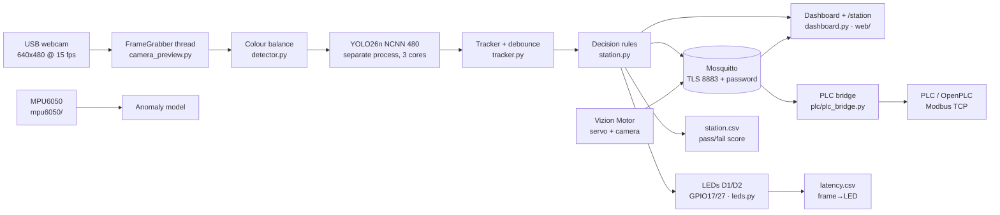

# Vizion · architecture and software stack

## Data flow

## Software stack (bottom to top)

| Layer | What | Version |
|---|---|---|
| Hardware | Raspberry Pi 5 4 GB (4× Cortex-A76 @ 2.4 GHz), Arkmicro USB2.0 webcam, LEDs, SG90 servo, MPU6050 | |
| OS | Raspberry Pi OS based on Debian 13 (64-bit) | |
| Runtime | Python 3.13 (container: 3.11), Docker (optional, `docker/`), systemd (`pi/system/`) | |
| Vision | OpenCV (capture, colour balance), Ultralytics 8.4.173 (model wrapper) | |
| Inference | **NCNN** on the CPU (ARM NEON), FP32, 480×480 input | about 41 ms/frame on 4 cores |
| Logic | tracker (debounce), station (pass/fail), latency log | this repo |
| I/O | gpiozero + lgpio (LEDs, servo), smbus2 (MPU6050 over I²C) | |
| Messaging | paho-mqtt 2.1 → Mosquitto 2.0 (TLS 1.2, password, ACL); pymodbus 3.8 → PLC | |
| UI | Python `http.server` + plain HTML/JS, Chromium kiosk | |

The Pi 5 has no NPU or GPU that NCNN can use here, so "accelerator" = the CPU's NEON SIMD units, with the detector in its own process so it runs in parallel with capture and the UI.
