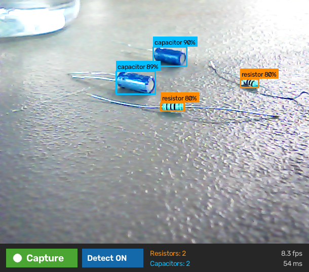

# Vizion resistor/capacitor detector (v3)

Finds resistors and capacitors in frames from the Vizion Raspberry Pi 5 USB webcam and draws a box around each part's body.



*Live on the Pi, in an arrangement the model never saw during training: all four parts found at 80–90% confidence.*

| | |
|---|---|
| Architecture | [Ultralytics YOLO26n](https://docs.ultralytics.com/) (2.6 M parameters), trained from the COCO-pretrained `yolo26n.pt` |
| Classes | `0` resistor, `1` capacitor (all types: electrolytic, ceramic, film, MLCC) |
| Boxes | Body only: leads and legs are not included |
| Deployed format | NCNN, fixed 480×480 input ([`vizion_ncnn_model/`](vizion_ncnn_model)) |
| PyTorch weights | [`vizion_yolo26n.pt`](vizion_yolo26n.pt), for re-export or further training |
| Trained | 2026-10-07: 99 epochs (stopped early, best at epoch 74), about 32 min on an RTX 4060 Laptop GPU, Ultralytics 8.4.173 |

## Files

| Path | What it is |
|---|---|
| `vizion_ncnn_model/` | The model the Pi runs: `model.ncnn.param`, `model.ncnn.bin` (9.2 MB), `metadata.yaml` (class names, input size) |
| `vizion_yolo26n.pt` | PyTorch checkpoint (5.2 MB), the source of the NCNN export |
| `training/args.yaml` | Exact training settings |
| `training/results.csv`, `results.png` | Loss and accuracy for every epoch |
| `training/confusion_matrix_normalized.png` | Validation confusion matrix |

## Results

On the public held-out test split (111 images, 75 resistors, 162 capacitors), scored by mean average precision (mAP) and recall:

| Input size | mAP50 | mAP50-95 | Resistor recall | Capacitor recall |
|---|---|---|---|---|
| **480 (deployed)** | 0.938 | 0.648 | 0.944 | 0.858 |
| 640 | 0.957 | 0.696 | 0.973 | 0.877 |

On the validation split (307 images), capacitor recall drops to 0.742 at 480 (0.791 at 640). Resistor recall is 1.000.

On frames from the Pi's own webcam, at input 480 and confidence 0.4:

| Check | v1 (public data only) | **v3 (this model)** |
|---|---|---|
| 15 hand-labelled frames, 52 parts | 12 found | **52 found, 0 false boxes** |
| Held-out webcam scene, 2 parts | 0 found | **2 found** |
| 11 room frames with no components | 0 false boxes | 0 false boxes |

**Speed on the Raspberry Pi 5** (CPU only, NCNN): about 41 ms per frame on 4 cores, and 49–57 ms when pinned to 3 cores as the Vizion app does. That is faster than the webcam delivers frames (15 fps, or about 8 fps in dim light).

## How it was trained

The full dataset is in [`../data`](../data).

| Source | Licence | How it was used |
|---|---|---|
| [ElectroCom61](https://data.mendeley.com/datasets/6scy6h8sjz/2), 61 component classes, 640×640 | CC BY 4.0 | Its 6 capacitor classes merged into one. Its boxes include the leads, so capacitor boxes were shrunk to the body automatically (GrabCut, then a morphological opening removes the thin legs); images where that failed were dropped. Images containing resistors were dropped. Images with look-alike parts (inductors, diodes, Zener diodes, fuses, NTC thermistors) were kept as negatives. |
| [Kaggle: resistor-diode-capacitor-ic](https://www.kaggle.com/datasets/akeshm/resistor-diode-capacitor-ic), 4000 px breadboard photos | Not stated | Rotated to their EXIF orientation (the labels match that view), then cut into overlapping 1600 px tiles so parts are a usable size |
| [Kaggle: resistor-images-dataset-for-segmentation](https://www.kaggle.com/datasets/alptugaydin/resistor-images-dataset-for-segmentation) | CC BY 4.0 | Resistor outlines converted to boxes |
| Vizion webcam frames (own) | — | 15 frames (4 scenes) with hand-checked boxes, plus 600 synthetic scenes: the parts cut out and pasted at random angles and sizes onto the empty table |

Half of the public training images were also degraded to look like the webcam: softened, noisy, colour-shifted and JPEG-compressed.

| Split | Images | Resistor boxes | Capacitor boxes | Images with no parts |
|---|---|---|---|---|
| Train | 1779 | 1427 | 2885 | 330 |
| Val | 307 | 59 | 392 | 53 |
| Test | 111 | 75 | 162 | 24 |

Augmentation: the Ultralytics defaults, plus vertical flips (`flipud=0.5`) and rotation up to ±10° (`degrees=10`).

## Colour balance before detection

In bright light the webcam's automatic white balance tints the whole picture cyan: red averaged 136 against about 190 for green and blue. Blue capacitors wash out, and the model's capacitor confidence fell to about 0.3, so capacitors appeared late or flickered. The Pi app therefore balances each frame to grey before detection (`balance_colours` in [`../pi/detector.py`](../pi/detector.py)): it scales the three colour channels so the scene averages to grey, ignores clipped and dark pixels, and limits the gains to 0.5–2. It costs about 4 ms per frame on the Pi.

| Check (input 480, confidence 0.25) | Without | With colour balance |
|---|---|---|
| 24 bright live frames: capacitor found | 15 / 24 (scores 0.14–0.4) | **24 / 24** (0.86–0.91) |
| 15 labelled webcam frames, 52 parts | 52 found, 0 false | 52 found, 0 false |
| Public test split, 237 parts | 220 found, 41 false | 219 found, 39 false |
| 11 room frames with no components | 0 false boxes | 0 false boxes |

Live on the Pi, the capacitor's tracked confidence went from 0.31–0.68 to a steady 0.89–0.91. If you run the model outside the Pi app, apply the same step to the frame first.

## Using the model

```python
from ultralytics import YOLO

model = YOLO("model/vizion_ncnn_model", task="detect")  # the folder name must end in _ncnn_model
result = model.predict("frame.jpg", imgsz=480, conf=0.4)[0]
for box in result.boxes:
    print(model.names[int(box.cls)], round(float(box.conf), 2), box.xyxy[0].tolist())
```

To set this up on a Raspberry Pi, install the CPU-only PyTorch first. The default ARM wheels on PyPI pull several GB of CUDA libraries the Pi cannot use.

```sh
pip install torch torchvision --index-url https://download.pytorch.org/whl/cpu
pip install ultralytics ncnn
```

For live video, run detection on every frame but smooth the results over time (the Vizion app uses a small tracker). Boxes from single frames move by a few pixels, and parts close to the threshold blink on and off.

To change the input size, re-export from the PyTorch weights:
`YOLO("vizion_yolo26n.pt").export(format="ncnn", imgsz=640)`.

## Limitations

- **Only a few real-camera scenes.** The webcam results come from 4 arrangements of the same 4 parts on one table, and the held-out webcam test is a single scene with 2 parts. Treat those numbers as encouraging, not conclusive. Other part types, steep angles, clutter or a different surface may be missed. Retraining with more varied webcam frames is the main way to improve.
- **Capacitors are harder than resistors.** Tiny ceramic and MLCC capacitors account for most misses on the public validation set (recall 0.74 at 480).
- **It finds parts but does not read them.** No resistor values from the colour bands, and no capacitor ratings.
- **Look-alikes.** Inductors, diodes and thermistors were trained as negatives, but confusion is still possible.
- **Lighting.** The webcam's auto-exposure and white balance cannot be locked. In dim light the frame rate falls and images get noisier. In bright light the picture turns cyan; see [Colour balance](#colour-balance-before-detection) for the fix the Pi app applies.

## Licence

- The model is fine-tuned from Ultralytics YOLO26, which is licensed under **AGPL-3.0**, and inherits those terms. Using it in closed-source commercial products requires an Ultralytics Enterprise Licence.
- Training data credits:
  - ElectroCom61: M. F. A. Sayeedi et al., *ElectroCom61: A Multiclass Dataset for Detection of Electronic Components*, Mendeley Data V2, doi:[10.17632/6scy6h8sjz.2](https://doi.org/10.17632/6scy6h8sjz.2), CC BY 4.0.
  - Resistor images: alptugaydin, Kaggle, CC BY 4.0.
  - The akeshm Kaggle dataset does not state a licence. Check with its author before redistributing this model publicly.
