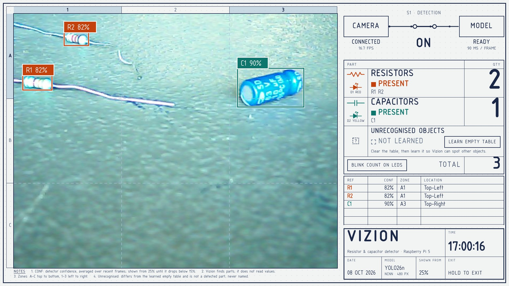

# Vizion on the Raspberry Pi

Everything that runs on the Pi: a full-screen dashboard that shows the camera with every resistor and capacitor marked, two LEDs that light up for them, and a simple camera preview for taking training photos.



## Files

| File | What it does |
|---|---|
| `run_dashboard.sh` | Opens the dashboard full screen (Chromium kiosk). The normal way to run Vizion |
| `dashboard.py` | The dashboard's server: camera, detector, tracker, LEDs, and the web page (Python standard library only) |
| `dashboard_logic.py` | Zones (A1–C3), designators (R1, C1), counts, and the unrecognised-object check |
| `web/` | The page: `index.html`, `dashboard.css`, `dashboard.js`, and the ISO 3098 font (osifont) |
| `leds.py` | The two indicator LEDs |
| `detector.py` | Runs the NCNN model in its own process and colour-balances frames first |
| `tracker.py` | Smooths boxes over time so they don't jitter or blink, and counts each part once |
| `camera_preview.py`, `run_preview.sh` | A plain preview window with a Capture button, for collecting training frames |
| `models/vizion_ncnn_model/` | The detector ([model card](../model/README.md)) |
| `vizion-dashboard.desktop`, `vizion-camera.desktop` | Desktop icons |
| `system/wifi-powersave-off.conf` | Turns Wi-Fi power saving off (the Pi kept dropping off the network) |
| `test_*.py` | Tests. They need no camera, model or GPIO: `python test_tracker.py` and so on |

## Setup

Tested on a Raspberry Pi 5 (4 GB) with Raspberry Pi OS based on Debian 13, Python 3.13, and an Arkmicro USB2.0 PC CAMERA.

```sh
git clone https://github.com/TringyTrongy/vizion.git
mkdir -p ~/vizion && cp -r vizion/pi/. ~/vizion/
cd ~/vizion

# --system-site-packages: gpiozero and lgpio for the LEDs come with Raspberry Pi OS
python3 -m venv --system-site-packages .venv
# CPU-only PyTorch first: the default ARM wheels pull several GB of CUDA libraries the Pi can't use
.venv/bin/pip install torch torchvision --index-url https://download.pytorch.org/whl/cpu
.venv/bin/pip install ultralytics ncnn opencv-python

chmod +x run_dashboard.sh run_preview.sh
cp vizion-dashboard.desktop vizion-camera.desktop ~/Desktop/      # optional icons

# optional: keep Wi-Fi from dropping out
sudo cp system/wifi-powersave-off.conf /etc/NetworkManager/conf.d/ && sudo systemctl restart NetworkManager
```

The preview window's labels need a font inside OpenCV's Qt folder: `ln -s /usr/share/fonts/truetype/dejavu .venv/lib/python3.13/site-packages/cv2/qt/fonts`.

## Running the dashboard

```sh
cd ~/vizion
./run_dashboard.sh
```

Or double-click **Vizion Dashboard** on the desktop. It works over SSH too, and opens on the Pi's own monitor. The camera can only be used by one program at a time, so the launcher closes the camera preview if it is open.

| Control | Mouse or touch | Key |
|---|---|---|
| Detection on/off (the camera keeps running) | the **S1** switch | D |
| Learn the empty table, for unrecognised objects | **Learn empty table** | L |
| Blink the counts on the LEDs | **Blink count on LEDs** | B |
| Exit | hold **EXIT** for one second | Q or Esc |

Options (add them after `./run_dashboard.sh`):

| Option | Default | Meaning |
|---|---|---|
| `--conf 0.3` | 0.25 | Confidence a part needs before it is shown. It stays shown until it drops below 60% of this |
| `--resistor-led 17:red` | 17:red | GPIO number and colour of the resistor LED, or `none` |
| `--capacitor-led 27:yellow` | 27:yellow | GPIO number and colour of the capacitor LED, or `none` |
| `--host 0.0.0.0` | 127.0.0.1 | Lets other computers watch at `http://<pi-address>:8765/`. Anyone on the network can then also switch detection and close it |
| `--source <folder>` | | Test: plays image files instead of the camera. The screen says TEST IMAGES |

The log is `~/vizion/dashboard.log`.

### What the screen shows

- **Camera:** each part is boxed and labelled like a schematic, for example `R1 82%`. The rulers name the 3×3 zones, A–C top to bottom and 1–3 left to right.
- **Parts list:** how many resistors and capacitors there are, PRESENT / NOT PRESENT, the TOTAL, and the two LEDs (D1, D2), which light on screen when the real ones do.
- **Per-part table:** designator, confidence, zone, and location (Top-Left … Bottom-Right).
- **Pipeline:** CAMERA → S1 → MODEL with live status. Faults show here (no camera signal, model restarting), and Vizion recovers by itself when the camera is plugged back in or the model process dies.
- **Title block:** the time, date, model and threshold.

**Unrecognised objects.** The model only knows resistors and capacitors. Clear the table and press **Learn empty table** once. After that, anything that differs from that picture and isn't a detected part is outlined with a `?`. It is never named. Learn the table again after moving the camera or changing the lighting.

## LEDs

One LED lights for resistors and one for capacitors:

- **Steady on:** while at least one part of its kind is detected.
- **Off:** when none is detected, when detection is switched off, when the camera is lost, and when the dashboard closes.
- **Blink count:** the button (or B) blinks the red LED once per resistor, then, after a pause, the yellow LED once per capacitor, using the counts at the moment you press it. Then both go back to steady.

### Wiring

Hold the Pi with the 40-pin header along the top and the USB/Ethernet ports on the right; pin 1 is at the left end. Odd pins are on the inner row, even pins on the row along the board edge.

```
              inner row   board edge
   3V3         [ 1]  [ 2]  5V      <- never connect an LED here
   GPIO2       [ 3]  [ 4]  5V      <- or here
   GPIO3       [ 5]  [ 6]  GND
   GPIO4       [ 7]  [ 8]  GPIO14
   GND (red −) [ 9]  [10]  GPIO15
   GPIO17 (red)[11]  [12]  GPIO18
GPIO27 (yellow)[13]  [14]  GND (yellow −)
```

```
Pin 11 (GPIO17) ── 220 Ω ── (+ long leg) RED LED    (− short leg) ── Pin 9  (GND)   resistors
Pin 13 (GPIO27) ── 220 Ω ── (+ long leg) YELLOW LED (− short leg) ── Pin 14 (GND)   capacitors
```

- **One resistor per LED, always.** Use 220 Ω (red-red-brown) for red, yellow or orange LEDs, and 100 Ω for blue, white or bright green ones.
- **Female-to-female jumpers:** twist a resistor leg around the LED's long leg, tape the joint, and push the free legs into the jumpers. Fold a leg double if it's loose in the socket.
- **Wire it with the Pi off.** An LED fitted backwards just stays dark; turn it round.
- **Quick test** from a terminal: `pinctrl set 17 op dh` (on) and `pinctrl set 17 dl` (off); the same with 27.

## How detection works

```
USB camera ─► FrameGrabber thread (newest frame only, 15 fps cap)
                 ├─► web page: JPEG + state, one frame at a time
                 └─► detector process: colour balance ─► YOLO26n (NCNN, 480 px, ~50–90 ms)
                          └─► tracker: smoothed boxes, one track per part ─► counts, zones, LEDs
```

- **Separate process.** The model runs in its own process on three of the four cores, because the NCNN binding holds Python's GIL and would otherwise stall the video.
- **Colour balance.** In bright light the webcam turns everything cyan and blue capacitors wash out, so each frame is colour-balanced before detection. This raised capacitor confidence from about 0.3 to 0.9 in bright light; the numbers are in the [model card](../model/README.md#colour-balance-before-detection).
- **Tracker.** The tracker shows a part once it is seen twice above the threshold, keeps it through a few missed frames, and keeps its designator while it stays. The confidence on screen is the detector's score averaged over recent frames.

## Troubleshooting

- **"No camera signal".** Check the USB cable. Vizion retries every 2 seconds and carries on by itself.
- **The dashboard won't start.** Read `~/vizion/dashboard.log`. "Cannot serve on 127.0.0.1:8765" means another copy is running; the launcher closes it, so just run it again.
- **Heat.** The Pi runs at about 75 °C without a fan while detecting. The Raspberry Pi 5 Active Cooler stops it throttling.
- **The Pi drops off Wi-Fi.** Install `system/wifi-powersave-off.conf`, as in Setup.
