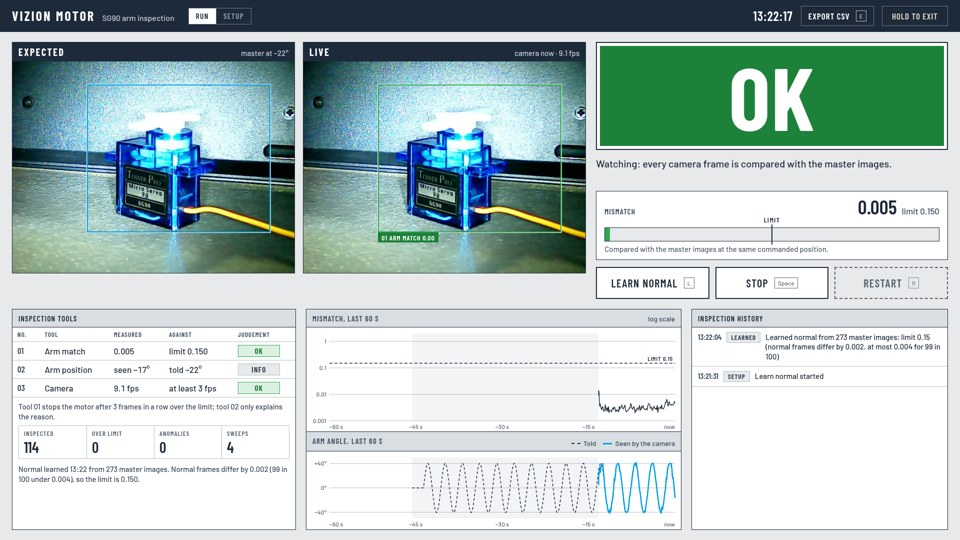

# Vizion Motor

A dashboard that detects anomalies in a hobby servo motor by watching it with the webcam. When the arm doesn't move the way it was told to, for example because someone holds it, something blocks it or it has lost power, Vizion Motor stops driving the motor, flashes the red LED and shows the evidence. It stays stopped until someone presses Restart.

It is separate from the other two Vizion dashboards: the resistor and capacitor camera (`pi/web/`, port 8765) and Vizion Sense, the DHT11 monitor (`pi/sensor_monitor/`, port 8766).



## Why a camera?

The motor is an SG90 hobby servo. It has three wires: power, ground and the position command. Nothing comes back from it. The Pi can tell the arm where to go, but it cannot ask where the arm actually is, so something has to watch it.

Before choosing, these signals were measured on the Pi (10 October 2026):

| Signal | Result |
|---|---|
| The Pi's 5 V supply reading (`vcgencmd pmic_read_adc EXT5V_V`) | 5.143 V whether the servo was off, holding, or reversing flat out: it doesn't show motor load |
| The webcam's built-in microphone | Sound levels from 20 Hz to 8 kHz were the same with the servo quiet and sweeping, at two distances: room noise hides the servo |
| The webcam, pointed at the servo | The arm was the only thing in the picture that moved: this is the signal Vizion Motor uses |

A current sensor (such as an INA219) or a servo with a feedback wire would also work, but both need extra hardware.

## How it works

1. **Learn normal (32 s).**
   - The arm holds still in the middle for 2 s, then sweeps ±40° every 3 s for 30 s.
   - The camera records about 270 pictures. Each one is tagged with where the arm was told to be and which way it was moving. These are the *master images*.
   - The part of the picture that moved during the sweep (but not while the arm held still) becomes the arm's region, the box you see on screen. Only that region is compared from then on.
2. **Set the limit.**
   - Every master image is compared with the others taken at the same position on other sweeps.
   - The 99th percentile of those normal differences, times 4, is the limit, but never less than 0.15.
3. **Inspect every frame (about 9 a second).**
   - Each new frame is compared with the master images at the same commanded position, moving the same way.
   - The smallest difference is the *mismatch*. It is computed on brightness-normalised pictures, so the room getting a little brighter or darker doesn't count on its own.
4. **Trip.**
   - A mismatch over the limit for **3 frames in a row** (about a third of a second) is an anomaly.
   - The servo gets no more pulses, so the arm goes limp and isn't strained. The red LED flashes and the two pictures that tripped it are saved.
   - It stays stopped until **Restart**.
5. **Stopped is watched too.**
   - After **Stop**, the arm parks in the middle and the pulses stop.
   - Frames are then compared with the still master images, so a push on the arm is also an anomaly.

**What an anomaly means:** the arm did not look the way it normally does at that moment. A hand on the arm, a blocked or unpowered servo, or something in front of the camera all cause one. It is never proof that the motor is broken.

The reason sentence says what was seen:
- the arm stopped moving while it was told to move;
- the arm was at a different angle from the command;
- or the arm didn't look normal (usually something covering it).

## Measured so far

| What | Where | Result |
|---|---|---|
| Learn normal on the real servo (side view, room light) | Pi, 10 Oct 2026 | 273 master images at 9.1 frames a second. Normal frames differ by 0.0018 (99 in 100 under 0.0043), so the limit is the 0.15 floor |
| A hand holding the arm | Hold-test recording, 10 Oct 2026 | Frames with the hand on the arm scored 0.83–1.19; normal sweeping scored 0.01–0.03 |
| Hand on arm, stuck arm, push while stopped, covered camera | Simulated rig (tests) | All trip within a second; normal sweeping never trips |

These are small samples. Only a few hold tests were recorded, so treat the margins as encouraging, not proven.

## Setting it up

**Wiring:** the same as Vizion Sense.

| Part | Pi header |
|---|---|
| SG90 servo | brown → pin 20 (GND), red → pin 4 (5 V), orange → pin 12 (GPIO18) |
| Red LED (anomaly) | + → pin 11 (GPIO17), − → pin 9, through its resistor |
| Yellow LED (running) | + → pin 13 (GPIO27), − → pin 14, through its resistor |
| Webcam | USB, pointed at the servo from 15–25 cm with the whole arm swing in view |

**Steady pictures:**
- Tape the servo down if you can, so holding the arm doesn't slide it.
- Keep the camera and the light where they are.
- If either moves, press Learn normal again.

**Software:** it runs from the project's `.venv` (numpy, OpenCV, lgpio from the system packages). Nothing else needs installing.

## Running it

```sh
cd ~/vizion
./run_motor.sh                  # full screen on the Pi's monitor
./run_motor.sh --host 0.0.0.0   # also reachable from a laptop at http://<pi-address>:8767/
```

Vizion Motor needs the webcam (like the camera dashboard) and the servo and LEDs (like Vizion Sense), so close those two first. The launcher warns you if either is open.

Without the hardware, try it on a drawn arm:

```sh
python motor_monitor/motor_dashboard.py --rig sim --data /tmp/vizion-motor
```

The page then shows **Simulated rig** and a Simulator row (Hand on arm, Arm stuck, Push arm, Cover camera, Clear).

Other options:
- `--fresh` ignores the saved normal.
- `--leds off` leaves the LEDs alone.
- `--data DIR` keeps the logs somewhere else.
- `--no-log` writes nothing.

## The screen

| Part | What it shows |
|---|---|
| **Lamp** | OK (green, watching), ANOMALY (red), STOPPED, LEARNING (with a 32-segment progress bar), NOT LEARNED, NO CAMERA (the motor is stopped because it can't be watched) |
| **Expected / Live** | The master image for the arm's current commanded position, next to the camera's view. The box is the arm's region. After a trip, both panes hold the frames that tripped it |
| **Mismatch bar** | The mismatch against the limit (the tick in the middle) |
| **Inspection tools** | 01 Arm match: the only tool that stops the motor. 02 Arm position: where the camera thinks the arm is, against where it was told, which explains the reason. 03 Camera: frame rate |
| **Trends** | The mismatch for the last 60 s on a log scale with the limit line, and the arm angle told versus seen. Grey bands mark times the arm wasn't sweeping; red lines mark trips |
| **Inspection history** | Learning, starts, stops and anomalies, each anomaly with its two saved pictures |

Keys:
- **L** Learn normal.
- **Space** Start / Stop.
- **R** Restart.
- **E** Export CSV (this session, today or everything).
- In kiosk mode, **Q** or **Esc** exits, or hold "Hold to exit" for a second.

## Files it writes (`motor_monitor/data/`, not in the repo)

| File | Contents |
|---|---|
| `log/motor-watch-YYYY-MM-DD.csv` | Every inspected frame: `timestamp, state, command_us, command_deg, seen_deg, mismatch, limit, event` |
| `evidence/NNNNN-expected.jpg`, `NNNNN-live.jpg` | The two pictures of each anomaly (NNNNN is the event number) |
| `master.npz` | The learned normal, so a restart doesn't need learning again |

## Files

| File | What it is |
|---|---|
| `motor_watch.py` | The detector and the run state: learning, the limit, inspecting frames, trips, the servo command and the LEDs. numpy only |
| `motor_rig.py` | The hardware: servo and LEDs through lgpio, the webcam through OpenCV, and `SimRig`, a drawn arm for trying it without hardware |
| `motor_dashboard.py` | The web server (Python standard library) on port 8767, the camera and motion threads, the CSV log and the evidence pictures |
| `web/` | The page: `index.html`, `motor.css`, `motor.js`, and the self-hosted Barlow fonts (SIL Open Font License, `web/fonts/OFL.txt`) |
| `test_motor_monitor.py` | 20 tests on the simulated rig with a made-up clock: no camera or GPIO needed. Run `python motor_monitor/test_motor_monitor.py` |
| `PRODUCT.md`, `.impeccable/surfaces/` | Who it is for and the design brief (Vision Inspection Station direction), for the Impeccable design workflow |

## Limits

- It knows *that* the arm looks wrong, not exactly *why*. A hand waving between the camera and the arm is also an anomaly.
- If the servo or camera moves, or the lighting changes a lot (for example, a lamp switched on behind the servo), learn normal again.
- At about 9 frames a second it reacts in roughly a third of a second. A very brief touch between frames can be missed.
- Only one program can use the webcam, the servo or the LEDs at a time.
