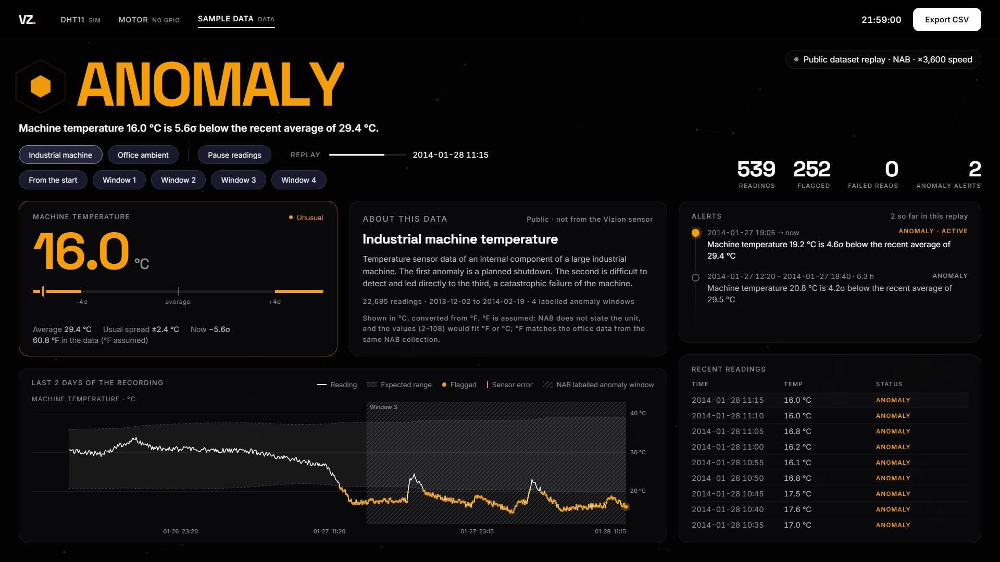
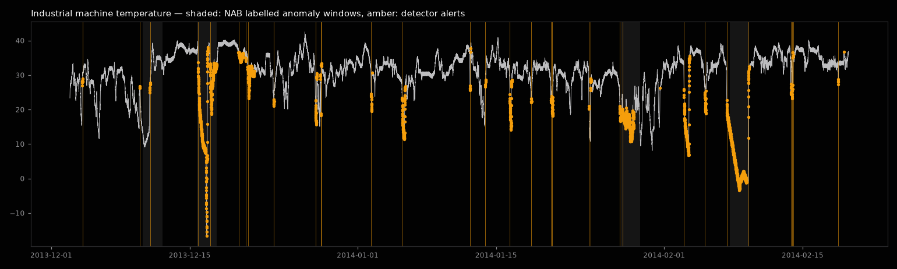

# Vizion Sense: temperature and humidity anomaly monitor

A DHT11 sensor on the Raspberry Pi 5, a simple anomaly detector that explains every alert, a "fan" (the SG90 servo) switched by the humidity with safety checks that shut it down, and a full-screen dashboard with CSV export. It is separate from the camera detector: its own folder, its own port (8766) and its own launcher. Nothing in the camera dashboard or the NCNN model changes.



The dashboard has three tabs, picked from the top bar:

| Tab | What it is |
|---|---|
| **DHT11** `LIVE` | The real sensor on GPIO4, read every 2 s. Every reading is logged on the Pi |
| **Motor** `LIVE` | The fan: the SG90 servo, switched on and off by the DHT11's humidity, with safety checks that shut it down ([Step 6](#step-6-the-fan-motor-tab)) |
| **Sample data** `DATA` | Replays of two public datasets through the same detector, picked with the pills inside the tab: **Industrial machine** (a machine's temperature, including a failure) and **Office ambient** (an office's temperature). It reopens the one you looked at last |

Each source has its own detector, alerts and history, and the screen always says which one you are looking at.

For development without a sensor, `--dht11 sim` feeds simulated readings instead. The tab then says **Simulated DHT11 · not a real sensor**, and the readings are logged as `simulated`, never as `dht11`.

To detect anomalies in the motor itself, such as someone holding the arm, use **Vizion Motor** ([../motor_monitor/README.md](../motor_monitor/README.md)). This dashboard's fan cannot see that (see Step 6).

## Files

| File | What it does |
|---|---|
| `sensor_dashboard.py` | The dashboard's server. Reads the sources, runs the detector, logs, serves the page |
| `sensor_reader.py` | The DHT11 reader for the Pi 5, the simulated DHT11 (`--dht11 sim`) and the dataset replay. Run it alone to test the sensor |
| `fan_control.py` | The fan: the servo and the LEDs, the humidity control (Auto / Hand / Off) and the safety checks |
| `anomaly_detector.py` | The detector rules and their settings (profiles) |
| `datasets.py` | Downloads and checks the public datasets |
| `evaluate.py` | Checks the detector against the labelled anomalies, or against your own recorded readings |
| `export_csv.py` | The readings log and CSV export, also from the terminal |
| `web/` | The page: `index.html`, `sensor.css`, `sensor.js`, fonts (Inter and Space Grotesk, SIL Open Font Licence) |
| `reports/` | The detector's results on the public data, with plots |
| `data/public/` | The downloaded datasets and `manifest.json` (where each file came from, its SHA-256) |
| `data/log/` | Made on the Pi: one CSV per day per source, e.g. `live-2026-10-09.csv`, and the fan's `motor-2026-10-10.csv` |
| `data/fan_settings.json` | Made on the Pi: the fan's mode and ON/OFF levels, kept between runs |
| `data/exports/` | Made on the Pi: every CSV exported from the dashboard |
| `test_sensor_monitor.py` | Tests. No sensor needed: `python test_sensor_monitor.py` |
| `../run_sensors.sh`, `../vizion-sensors.desktop` | Launcher and desktop icon |

All commands below are typed in a terminal on the Pi (on its desktop, or over SSH from your PC).

## Step 1: Connect the DHT11, the servo and the LEDs

**Turn the Pi off first** (`sudo poweroff`, then unplug it).

The DHT11 comes in two forms. Look at yours:

- **Module** (a small board, 3 pins, usually blue): it already has the pull-up resistor. Its pins are printed on the board: `+` or `VCC`, `OUT` or `S` or `DATA`, and `-` or `GND`. The order differs between makers, so go by the printing.
- **Bare sensor** (4 pins, no board): pins 1–4 from the left, looking at the grille: VCC, DATA, not connected, GND. Add a **10 kΩ resistor between DATA and VCC**.

| DHT11 pin | Pi header pin | |
|---|---|---|
| `+` / VCC | **pin 1** (3.3 V) | **Not 5 V.** At 5 V the data line would carry 5 V into the Pi's GPIO, which can damage it |
| `OUT` / `S` / DATA | **pin 7** (GPIO4) | |
| `-` / GND | **pin 6** (GND) | |

The fan is an SG90 servo: **brown** to pin 20 (GND), **red** to pin 4 (5 V) and **orange** (the signal) to pin 12 (GPIO18).

The two LEDs are the camera dashboard's (pins 9, 11, 13, 14, each through its own resistor). Here yellow means the fan is running and red flashes when it has shut down. Whichever dashboard starts first gets them; `--leds off` leaves them to the camera.

With the header along the top edge of the Pi and the USB ports on the right, pin 1 is at the left end of the inner row. Odd pins are on the inner row, even pins along the board edge.

```
              inner row   board edge
 DHT11 +  ->  3V3   [ 1]  [ 2]  5V        <- never the DHT11's + here
              GPIO2 [ 3]  [ 4]  5V        <- servo red
              GPIO3 [ 5]  [ 6]  GND       <- DHT11 -
 DHT11 OUT -> GPIO4 [ 7]  [ 8]  GPIO14
   red LED -  GND   [ 9]  [10]  GPIO15
   red LED +  GPIO17[11]  [12]  GPIO18    <- servo orange (signal)
yellow LED +  GPIO27[13]  [14]  GND       <- yellow LED -
              GPIO22[15]  [16]  GPIO23
              3V3   [17]  [18]  GPIO24
              GPIO10[19]  [20]  GND       <- servo brown
```

Turn the Pi on again.

### How the Pi 5 reads it

The old `Adafruit_DHT` library does not work on the Pi 5. Vizion uses one of two methods, whichever is available:

1. **lgpio** (the default, no setup). The Pi 5's GPIO library. The kernel timestamps every edge of the DHT11's reply and the program decodes the pulse lengths. An occasional read fails; the next one is 2 s later, and the dashboard only reports a sensor error after 3 failures in a row.
2. **The kernel's DHT11 driver** (more reliable, if lgpio fails often). Add one line to the boot settings and restart:
   ```sh
   echo "dtoverlay=dht11,gpiopin=4" | sudo tee -a /boot/firmware/config.txt
   sudo reboot
   ```
   After the restart Vizion uses it by itself. To undo it, delete that last line from `/boot/firmware/config.txt` and restart.

### Test the sensor

```sh
cd ~/vizion
.venv/bin/python sensor_monitor/sensor_reader.py
```

Each line should show a temperature and humidity. Breathe on the sensor: the humidity should rise within a few seconds. Stop with **Ctrl+C**. It then prints how many reads worked.

```
Reading the DHT11 on GPIO4 with lgpio. Ctrl+C to stop.
14:02:10   26.0 °C   55.0 %
14:02:12   26.0 °C   55.0 %
```

If every line says `No reply from the DHT11`, check the wiring and the power pin. If many say `checksum mismatch` or `Incomplete reply`, **reseat or swap the jumper wires first**: on 10 October a loose jumper caused exactly this, and the readings were clean after rewiring. Then try shorter wires or the kernel driver above.

## Step 2: Get the public datasets

```sh
cd ~/vizion/sensor_monitor
../.venv/bin/python datasets.py
```

It downloads two files from the Numenta Anomaly Benchmark (NAB), plus the labels and NAB's licence (MIT). It counts the rows and reads every line before it reports success. If GitHub times out, it tries the same files through jsDelivr by itself. Expected output:

```
OK  machine  22695 rows, 2013-12-02 to 2014-02-19, every 5 min, values 2.1 to 108.5, 1 irregular steps (gaps or clock changes), 4 labelled anomaly windows
OK  ambient  7267 rows, 2013-07-04 to 2014-05-28, every 60 min, values 57.5 to 86.2, 10 irregular steps (gaps or clock changes), 2 labelled anomaly windows
All files are present and complete.
```

What is in them, as checked:

- **Industrial machine temperature** (`machine_temperature_system_failure.csv`). A temperature sensor inside a large industrial machine. NAB's notes say the first anomaly is a planned shutdown, and the second is hard to detect and led directly to the third, a catastrophic failure. NAB marks 4 labelled anomaly windows. The clock jumps back once by an hour (12 repeated timestamps on 2014-01-07).
- **Office ambient temperature** (`ambient_temperature_system_failure.csv`). Hourly, with 10 gaps of up to 7 days. 2 labelled windows.
- **Neither file states its unit.** The office values (57–86) can only be an office temperature in °F (14–30 °C), so °F is *inferred*. The machine values (2–108) would fit °F or °C; °F is *assumed*, to match the office data from the same collection. The dashboard converts both to °C, like the DHT11, and shows the dataset's own °F number beside it. If you learn the machine's real unit, change `"unit"` for `machine` in `datasets.py`.

These are not DHT11 readings. They are for building and testing the software; the detector still has to be checked on the real sensor (Step 7).

The **AI4I 2020 predictive maintenance** dataset is not used. It is synthetic, has no time series, and has nothing like a DHT11 in it. It would fit a later motor-maintenance project.

## Step 3: The detector

`anomaly_detector.py` checks every reading with three rules. Each alert names the rule that fired, with the numbers:

1. **Deviation.** The value is more than *k* standard deviations (σ) from the average of the recent normal readings: the rolling baseline. Unusual readings are kept out of the baseline, so a fault cannot teach the detector that it is normal. A change that lasts longer than the baseline window becomes the new normal.
   > Temperature 30.0 °C is 6.3σ above the recent average of 26.2 °C
2. **Sudden change.** The value moved by more than a set amount within a short time.
   > Temperature rose 2.2 °C in 30 s
3. **Limits.** The value is outside fixed limits. For the DHT11 these are its rated range, 0–50 °C and 20–90 %RH.

A failed or impossible reading is a **SENSOR ERROR**, never an anomaly. While the baseline is still being built (the first minute), only the limits and sudden changes are checked, and the screen says "Learning".

| Setting (DHT11) | Value | Why |
|---|---|---|
| Baseline window | 10 minutes (300 readings) | Long enough to be steady, short enough to follow the room |
| Threshold *k* | 4σ | |
| Smallest σ | 0.25 °C, 1 % | The sensor's resolution: a perfectly steady room must not turn every 1 % step into an alert |
| Sudden change | 2 °C or 8 % within 30 s | |
| Alert opens after | 2 unusual readings in a row (4 s) | One odd reading is logged but does not raise an alert |
| Sensor error after | 3 failed reads in a row (6 s) | Single failed reads are normal for a DHT11 |

**An anomaly only means the readings are unusual compared with the recent past.** It does not prove that anything has failed or is about to.

**Slow drift is a known miss.** A rolling baseline follows slow changes, so a simulated temperature that creeps up 3.5 °C over 6 minutes raises little or no alert. Catching drift needs another rule, such as a fixed limit or a much longer baseline.

No machine-learning model is used yet. Isolation Forest or similar is worth trying once there are a few days of real DHT11 logs to train and test it on, and only if it beats these rules on them.

## Step 4: How well it works on the public data

```sh
cd ~/vizion/sensor_monitor
../.venv/bin/python evaluate.py            # results, plus plots if matplotlib is installed
../.venv/bin/python evaluate.py --sweep    # how the settings were chosen
```

A labelled window counts as found when an alert starts inside it. Every alert that starts outside all windows counts as false, although some may be real events NAB did not label.

| Dataset | Settings | Windows found | False alerts |
|---|---|---|---|
| Industrial machine | 4σ from the last 2 days; a change of 11.1 °C (20 °F) within 1 h | **4 of 4** | 27 (2.4 per week of data) |
| Office ambient | 3σ from the last 14 days | **2 of 2** | 7 (0.1 per week) |

The full table, with when each window was found, is in [reports/nab_evaluation.md](reports/nab_evaluation.md).



The settings were picked on these same files, so the numbers flatter the detector. They show that the pipeline works, not how well it will do on the DHT11.

## Step 5: Run the dashboard

```sh
cd ~/vizion
./run_sensors.sh
```

Or double-click **Vizion Sense** on the desktop (copy `vizion-sensors.desktop` to `~/Desktop` first). It opens full screen on the Pi's monitor, on the Motor tab, also when started over SSH. It does not change the camera dashboard, but the two share the LEDs (Step 1), and Vizion Motor needs the same servo, so run one of those at a time.

| Control | Mouse or touch | Key |
|---|---|---|
| Choose the tab | the top bar | 1–3 |
| Choose the sample dataset | the **Industrial machine** / **Office ambient** pills in Sample data | |
| Export CSV | **Export CSV** | E |
| Pause or resume the readings (DHT11, Sample data) | **Pause readings** / **Resume readings** | P |
| Reset the readings | **Reset readings**, then tap again within 3 s to confirm | |
| The fan | the Motor tab's controls ([Step 6](#step-6-the-fan-motor-tab)) | |
| Exit | hold **Hold to exit** for a second | Q or Esc |

- **Pause** stops reading the sensor: nothing is read, checked or logged until you resume. The screen says PAUSED. On resume the detector carries on with the baseline it had.
- **Reset** clears the chart, alerts, counts and baseline, so the detector learns normal again for a minute. The CSV log on the Pi is kept; nothing recorded is deleted. In a replay, use **From the start** instead.

**No sensor yet?** The DHT11 tab shows SENSOR ERROR with the wiring, which is correct while nothing is connected. To try the dashboard anyway, start it with `./run_sensors.sh --dht11 sim`: the readings are then simulated, labelled as such and logged as `simulated`.

**From another computer:** start it with `./run_sensors.sh --host 0.0.0.0`, then open `http://<the Pi's address>:8766/` there. Anyone on the network can then see it, export the data and press the fan's buttons.

What the screen shows:

- **Status:** NORMAL, ANOMALY or SENSOR ERROR, with the reason in plain words. The hexagon and the background turn amber for an anomaly and rose for a sensor error.
- **Temperature and humidity:** the newest value and where it sits against the recent average. The bar's amber ends start at the threshold.
- **Chart:** the readings, the expected range (average ± kσ), flagged readings in amber and failed reads in rose. In replays, NAB's labelled windows are hatched.
- **Alerts:** each one with its start, its end or "active", and its reasons.
- **Recent readings:** the latest readings with their timestamps and status.
- **Motor tab:** the fan's state and reason, the humidity on a scale with its ON and OFF levels, a live dial of the servo, the safety checks, the timeline of starts, stops and shutdowns, and a chart of the humidity with the fan's run and shutdown times shaded.

The log is `~/vizion/sensor_monitor/sensor_dashboard.log`.

## Step 6: The fan (Motor tab)

The SG90 turns about 180° and cannot spin round, so while the fan "runs" it sweeps ±40° every 3 s, like an oscillating desk fan. It is controlled from the humidity the DHT11 reads.

| Mode | What it does |
|---|---|
| **Auto** | The fan starts when the humidity reaches the **ON** level and stops at the **OFF** level. The gap between them (hysteresis) stops it flicking on and off around one value |
| **Hand** | The fan runs whatever the humidity |
| **Off** | The fan stays stopped |

These are the Hand-Off-Auto switch of an industrial motor starter. The levels start at ON 75 % and OFF 70 %. Change them with **+** and **−**: ON 30–95 %, OFF at least 25 %, at least 2 % apart, since the DHT11 reads whole percent. They are kept in `data/fan_settings.json`.

**Safety checks.** When one fails, the fan shuts down: it stops, the red LED flashes, the timeline records why, and it stays stopped until you press **Restart**. Restart is refused while the DHT11 is still failing (in Auto) or the Pi still reports under-voltage.

| Check | Trips when | Why |
|---|---|---|
| Sensor answering (Auto) | The DHT11 has a SENSOR ERROR alert (3 failed reads in a row) | The humidity is unknown, so the fan can't be controlled |
| Fan has an effect (Auto) | It has run for 60 s and the humidity has not come down at all | A blocked or broken fan, or a moisture source too big for it |
| Not short cycling (Auto) | It is about to start for the 4th time within 3 minutes | Starting that often wears a motor out |
| Pi power | The Pi reports under-voltage while the fan runs | The servo shares the Pi's 5 V; a jammed motor on a weak supply can crash the Pi |
| Emergency stop | You press it | |

**What it cannot see:** the SG90 reports nothing back, neither its position nor its current, so a hand holding or turning the arm goes unnoticed here. The Pi's 5 V reading stayed at 5.143 V with the servo off, holding, or reversing flat out (measured 10 October). **Vizion Motor** watches the arm with the webcam instead ([../motor_monitor/README.md](../motor_monitor/README.md)).

The fan's state is logged once a second to `data/log/motor-YYYY-MM-DD.csv`, with these columns: `timestamp, humidity_percent, fan, state, mode, on_at, off_at, servo_pulse_us, event`.

## Step 7: Export the readings, and check the detector on them

**Export CSV** offers the last hour, today, this session (since the dashboard started or the readings were last reset), or everything. The file downloads in the browser (when the dashboard is opened from another computer) and is always saved on the Pi in `~/vizion/sensor_monitor/data/exports/`. From the terminal:

```sh
cd ~/vizion/sensor_monitor
../.venv/bin/python export_csv.py                                   # everything recorded
../.venv/bin/python export_csv.py --from 2026-10-09 --to 2026-10-10 -o today.csv
../.venv/bin/python export_csv.py --source motor                    # the fan's log instead
```

Columns: `timestamp, temperature_c, humidity_percent, anomaly_status, alert_reason, source`. Normal readings are included too. `source` is `dht11` for real readings and `simulated` for the simulator. A public dataset replay exports `timestamp, temperature_c, dataset_value, dataset_unit, anomaly_status, alert_reason, source`: the °C value, plus the number and unit as they are in the dataset. The Motor tab exports the fan's log (Step 6).

**Calibrate on the real sensor.** Leave the dashboard running for a day with the sensor in its normal place, then replay that day's log through the detector:

```sh
../.venv/bin/python evaluate.py --log data/log/live-2026-10-09.csv
```

Every alert it lists in a day of normal conditions is a false alarm. If there are too many, raise *k* or the smallest σ in the `DHT11` profile in `anomaly_detector.py`. Then breathe on the sensor or warm it with your hand, and check that this still raises an alert.

## Limitations

- **An anomaly is not a diagnosis.** The detector says the readings are unusual for this sensor recently, not why, and not that equipment has failed.
- **The DHT11 is a basic sensor:** ±2 °C and ±5 %RH, at most one reading per second, and a few seconds to react.
- **Slow changes are hard** for a rolling baseline (see Slow drift above).
- **Tuned on the test data.** The public-data settings were chosen on the same files they are scored on, and say little about the DHT11.
- **Logging stops when the dashboard closes.** Readings are recorded only while it runs.
- **The fan's checks watch the humidity and the Pi's power, not the motor itself.** A held or blocked arm is invisible to them (Step 6).

## Tests

```sh
cd ~/vizion/sensor_monitor
../.venv/bin/python test_sensor_monitor.py
```

They need no sensor, GPIO or network. The 27 tests cover the DHT11 decoder (on synthetic pulse trains), every detector rule, the alert grouping, the simulator, the CSV log, the fan controller (hysteresis, the modes, each safety check and Restart), and the server, including the fan's buttons.
